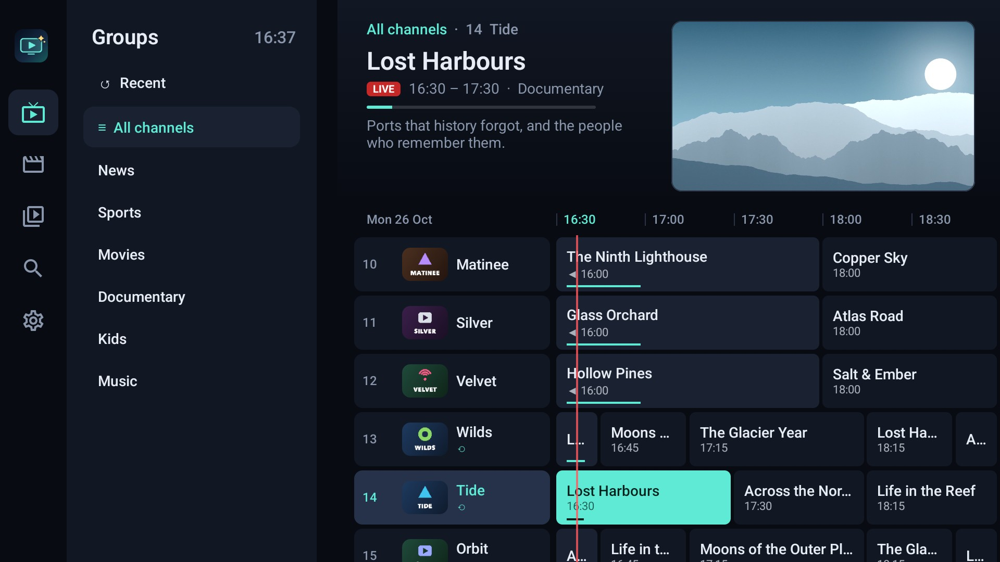
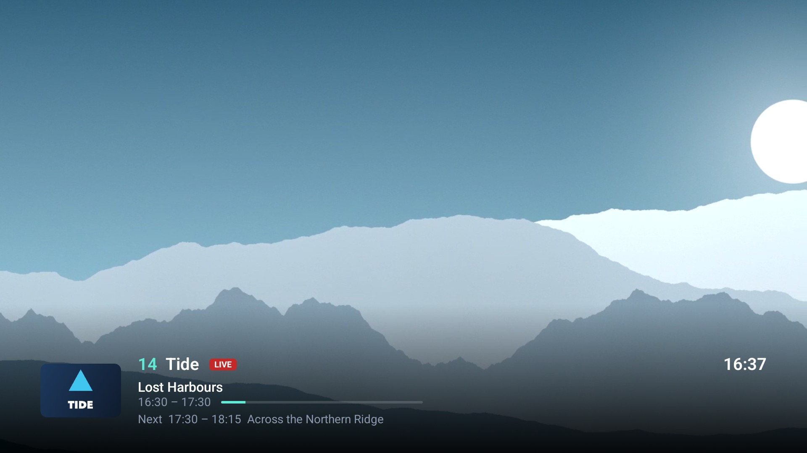
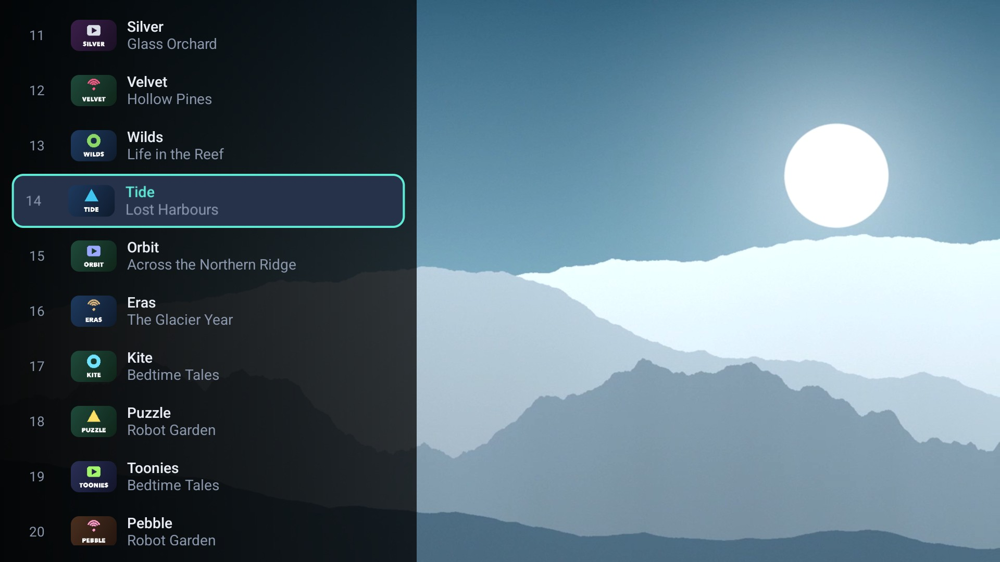
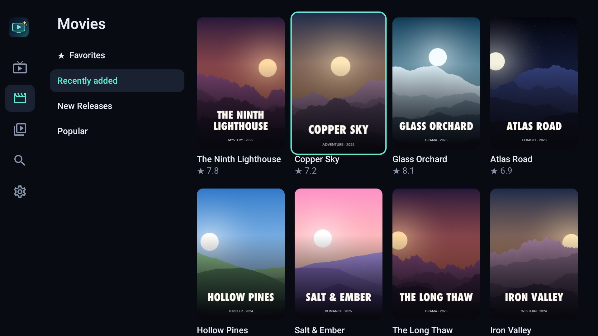
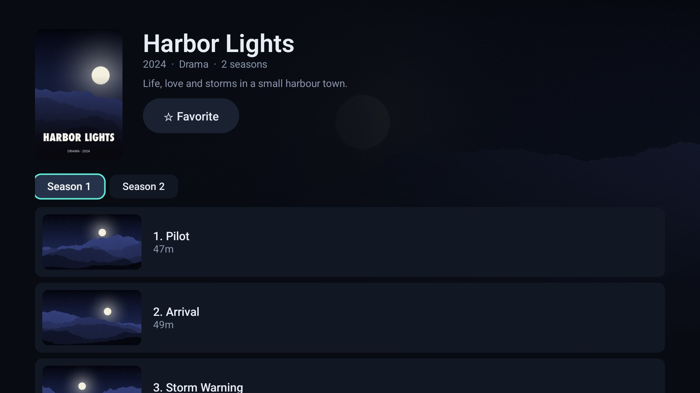

# IPTV Enhanced


**A free, open-source IPTV player for Android TV, Apple TV, and Android phones and tablets.** · [Website](https://amirdaraee.com/IPTV-Enhanced/)

IPTV Enhanced is a TV guide and player for the playlists you already have: M3U/M3U8 playlists with XMLTV guides, and Xtream logins (the player API). It ships no content, has no accounts, and collects no telemetry. Everything stays on the device.

> IPTV Enhanced is a player only. You are responsible for the content you load into it.



| | |
|-|-|
|  |  |
|  |  |

<sub>Screenshots from Android TV, using made-up demo channels. The Apple TV and phone apps look the same; see <a href="docs/store/apple-tv">docs/store/apple-tv</a> and <a href="docs/store/phone">docs/store/phone</a>.</sub>

## Get it

- **Android TV, Google TV, Fire TV and Android phones and tablets:** Google Play and the Amazon Appstore are coming soon. Until then, download the APK from [Releases](https://github.com/amirdaraee/IPTV-Enhanced/releases) and sideload it.
- **Apple TV:** the App Store is coming soon. Until then, you can [build it yourself](docs/development.md#installing-on-a-real-apple-tv).

## Getting started

1. Open the app and choose **Add your playlist**.
2. Enter an M3U playlist URL, or the server, username and password of an Xtream login. The guide is picked up automatically when the playlist or the provider includes one; you can also add extra guide URLs.
3. The channels and guide load in the background. The guide is the home screen.

No playlist yet? Try the demo playlist, which only contains freely shareable streams:

```
https://raw.githubusercontent.com/amirdaraee/IPTV-Enhanced/main/docs/demo/playlist.m3u
```

It has Big Buck Bunny (2008) and Tears of Steel (2012), © Blender Foundation, CC BY 3.0 ([peach.blender.org](https://peach.blender.org), [mango.blender.org](https://mango.blender.org)), streamed from Mux's public test streams, and Apple's sample HLS streams.

## Features (v0.1)

**Sources**
- Unlimited M3U/M3U8 playlists and Xtream logins.
- gzip-aware streaming import that handles playlists of any size.
- Custom User-Agent per source; `#EXTVLCOPT`, `#KODIPROP` and `url|Header=` headers are respected.
- Automatic refresh on start once a source is older than its interval.

**TV guide**
- XMLTV is streamed straight into SQLite, so 100 MB+ guides never sit in memory.
- Guide sources: the playlist's `url-tvg`, Xtream's `xmltv.php`, and extra URLs you add.
- Channels match guide data by `tvg-id`, with a normalised channel-name fallback.
- Per-source time shift, and configurable past and future retention.

**Live TV**
- A grid guide is the home screen, with a live preview and a clock. The group list is always shown beside it; OK on a channel name plays it fullscreen.
- Play/Pause puts the guide back on the current time; "Earlier programmes" (or Rewind) goes back for catch-up.
- Groups, Favorites, Recents and All channels; hide or reorder groups, hide channels (they also leave Favorites and Recents), and reorder Favorites.
- Optionally starts on the last channel you watched.
- "Add all to Favorites" for a whole search result (for example `uk news`) or a whole group; divider entries such as `##### SPORTS #####` are skipped.
- Fullscreen player with:
  - an info bar showing now/next;
  - a channel-list overlay;
  - up/down zapping;
  - number-key entry (Android) and last-channel recall;
  - a clock and a sleep timer (15 minutes to 2 hours);
  - auto-reconnect.

**Catch-up**
- Works with Xtream `tv_archive` and the M3U `catchup` modes: default, append, shift and flussonic.
- Xtream timeshift URLs are built in the server's own time zone.

**Movies and Series**
- Category grids, details, seasons and episodes.
- Resume and Continue watching, plus favorites.
- The next episode starts after a 10-second "Up next" countdown (can be turned off).
- Sleep timer: in the player's menu bar on Apple TV, and on the Menu key on Android.

**Everything else**
- Unified search across channels, movies, series and programmes on air in the next 24 hours, with your recent searches one press away.
- Preferred audio and subtitle language, applied to every stream.
- A reminder at launch, and a highlighted status in Settings, when an Xtream subscription ends within 7 days.
- Parental PIN: lock channels or groups (with a brute-force lockout), and protect settings.
- Back behaves predictably everywhere: it closes the innermost thing first (keyboard, overlay, programme → channel name → group list, category list), returns to Live TV from other tabs, and only then asks to exit. Forms ask before discarding typing.

**Your data**
- Playlists, favorites, hidden/locked/reordered groups, watch progress, recents and settings are kept in a small backup copy that the core rewrites whenever they change. If the app starts with an empty database, it restores from that copy and re-syncs the channels.
- **Apple TV:** the database has to live in Caches (a real Apple TV doesn't let apps write elsewhere), which tvOS may purge; the backup copy lives in the Keychain, which is never purged and survives reinstalls. iCloud sync is planned once the project has a paid Apple developer account.
- **Android TV:** the database lives in app storage, which the system doesn't purge. The copy (`files/user-data.json`) is the only thing Android's backup to Google may include, and only when that backup is end-to-end encrypted. Fire TV has no Google backup.

## Platforms

| | Android TV / Google TV, phones and tablets | Apple TV |
|-|--------------------------------------------|----------|
| Minimum OS | Android 7.0 (API 24) | tvOS 17 |
| UI | Jetpack Compose for TV | SwiftUI (native focus engine) |
| Player | Media3 ExoPlayer: HLS, DASH, MPEG-TS, MP4, MKV | AVPlayer: HLS, MP4 (Xtream live uses HLS) |

## Remote controls

| | OK | Hold OK / Menu | Back | Up/Down | Left/Right |
|-|----|----------------|------|---------|-----------|
| Guide: groups | Open the group's channels | Group menu (reorder, hide, lock, add all to Favorites) | Side menu → exit prompt | Groups | Side menu / channel names |
| Guide: channel name | Play live, fullscreen | Context menu | Group list | Channels | Group list / programmes |
| Guide: programme | Preview, then fullscreen; past programme → catch-up | Context menu | Channel name | Channels | Time (Left of the live programme returns to the channel name; Rewind/Fast-forward jump 2 hours) |
| Live player | Channel list | Options (favorite, picture, sleep timer, previous channel, audio and subtitles) | Cancel number entry / close overlay → guide (on the channel you were watching) | Zap | Info bar |
| Movies / Series | Open | Context menu | Grid → category list → side menu → Live TV | Rows | Columns |
| Movie player | Play/pause | | Hide controls while playing, otherwise leave | | Seek |

On Apple TV, the Siri Remote clickpad and swipes map to the same actions. Menu acts as Back. On Apple TV, Back from the group list goes to the tab bar; from the Movies and Series category lists and from Settings it goes to Live TV.

### Touch screens

On Android phones and tablets the same screens work with touch. The app runs full screen in landscape, scaled so a phone shows the whole guide.

- **Guide:** tap a programme to preview it (or play it from catch-up), tap a channel name or the preview to watch fullscreen, long-press for the menu. Swipe up and down through channels, sideways through time.
- **Live player:** tap for the info bar with Channels and Options (and seek and pause for catch-up), swipe up or down to change channel, long-press for options.
- **Everywhere else:** tap where the remote would press OK, long-press where it would hold OK, and use the system Back gesture as Back.

## Privacy

The app collects no data. See the [privacy policy](docs/privacy.md).

## Contributing

Bug reports and pull requests are welcome. [docs/development.md](docs/development.md) covers the architecture, building, the test server and releases.

## License

GPL-3.0-or-later. See [LICENSE](LICENSE).

All code in this repository was written for this project. The only third-party files are Gradle's standard wrapper scripts (`gradlew`, `gradlew.bat`, `gradle/wrapper`), which are Apache-2.0, and the licence texts in `licenses/`. Libraries are fetched as build dependencies and are not vendored. The apps show the licence and the notices for the libraries they include (`licenses/third-party.txt`) under Settings → About; update that file when a dependency changes.
