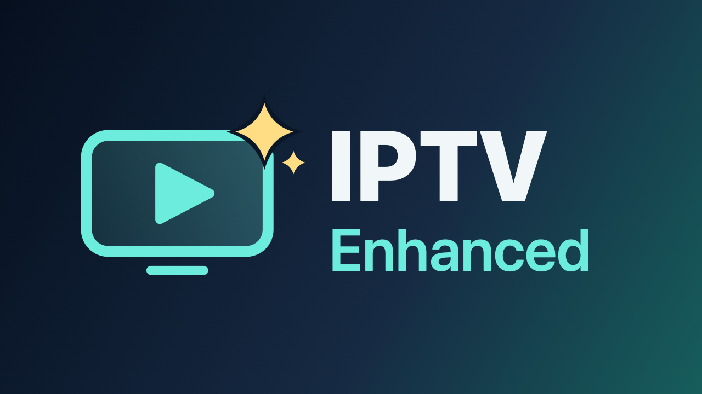

# IPTV Enhanced



**A free, open-source IPTV player for Android TV and Apple TV.**

IPTV Enhanced is a TV guide and player for the playlists you already have: M3U/M3U8 playlists with XMLTV guides, and Xtream Codes accounts. It ships no content, has no accounts, and collects no telemetry. Everything stays on the device.

> IPTV Enhanced is a player only. You are responsible for the content you load into it.

## Features (v0.1)

**Sources**
- Unlimited M3U/M3U8 playlists and Xtream Codes accounts.
- gzip-aware streaming import that handles playlists of any size.
- Custom User-Agent per source; `#EXTVLCOPT`, `#KODIPROP` and `url|Header=` headers are respected.
- Automatic refresh on start once a source is older than its interval.

**TV guide**
- XMLTV is streamed straight into SQLite, so 100 MB+ guides never sit in memory.
- Guide sources: the playlist's `url-tvg`, Xtream's `xmltv.php`, and extra URLs you add.
- Channels match guide data by `tvg-id`, with a normalised channel-name fallback.
- Per-source time shift, and configurable past and future retention.

**Live TV**
- A grid guide is the home screen, with a live preview and a clock. The group list is always shown beside it; OK on a channel name plays it fullscreen.
- Play/Pause puts the guide back on the current time; "Earlier programmes" (or Rewind) goes back for catch-up.
- Groups, Favorites, Recents and All channels; hide or reorder groups, hide channels, and reorder Favorites.
- Optionally starts on the last channel you watched.
- "Add all to Favorites" for a whole search result (for example `uk news`) or a whole group; divider entries such as `##### SPORTS #####` are skipped.
- Fullscreen player with:
  - an info bar showing now/next;
  - a channel-list overlay;
  - up/down zapping;
  - number-key entry (Android) and last-channel recall;
  - a clock and a sleep timer (15 minutes to 2 hours);
  - auto-reconnect.

**Catch-up**
- Works with Xtream `tv_archive` and the M3U `catchup` modes: default, append, shift and flussonic.
- Xtream timeshift URLs are built in the server's own time zone.

**Movies and Series**
- Category grids, details, seasons and episodes.
- Resume and Continue watching, plus favorites.
- The next episode starts after a 10-second "Up next" countdown (can be turned off).
- Sleep timer: in the player's menu bar on Apple TV, and on the Menu key on Android.

**Everything else**
- Unified search across channels, movies, series and programmes on air in the next 24 hours, with your recent searches one press away.
- Preferred audio and subtitle language, applied to every stream.
- A reminder at launch, and a highlighted status in Settings, when an Xtream subscription ends within 7 days.
- Parental PIN: lock channels or groups (with a brute-force lockout), and protect settings.
- Back behaves predictably everywhere: it closes the innermost thing first (keyboard, overlay, programme → channel name → group list, category list), returns to Live TV from other tabs, and only then asks to exit. Forms ask before discarding typing.

**Your data**
- Playlists, favorites, hidden/locked/reordered groups, watch progress, recents and settings are kept in a small backup copy that the core rewrites whenever they change. If the app starts with an empty database, it restores from that copy and re-syncs the channels.
- **Apple TV:** the database has to live in Caches (a real Apple TV doesn't let apps write elsewhere), which tvOS may purge; the backup copy lives in the Keychain, which is never purged and survives reinstalls. iCloud sync is planned once the project has a paid Apple developer account.
- **Android TV:** the database lives in app storage, which the system doesn't purge. The copy (`files/user-data.json`) is the only thing Android's backup to Google may include, and only when that backup is end-to-end encrypted. Fire TV has no Google backup.

## Platforms

| | Android TV / Google TV | Apple TV |
|-|------------------------|----------|
| Minimum OS | Android 7.0 (API 24) | tvOS 17 |
| UI | Jetpack Compose for TV | SwiftUI (native focus engine) |
| Player | Media3 ExoPlayer: HLS, DASH, MPEG-TS, MP4, MKV | AVPlayer: HLS, MP4 (Xtream live uses HLS) |

## Architecture

```
shared/        Kotlin Multiplatform core: parsers, Xtream client, SQLDelight DB, sync, EPG import, facade
androidApp/    Android TV app (Compose for TV + Media3)
tvosApp/       tvOS app (SwiftUI); links the core as TunerCore.framework
tools/         fixture-server: local M3U/XMLTV/Xtream/HLS test server
docs/          spec, feature list, implementation plan and brand artwork
```

Both apps use one facade, `TunerCore` (called `Tuner` in Swift). The core keeps memory bounded on large providers in two ways:
- **Push parsers.** A streaming M3U parser and an XML tokenizer process network chunks as they arrive, through gzip detection, zlib and UTF-8 decoding.
- **Atomic sync.** New data is staged under a shadow source id and swapped in with a single transaction, so a failed refresh never leaves a half-updated lineup.

See [docs/spec/SPEC.md](docs/spec/SPEC.md) and [docs/plan/IMPLEMENTATION_PLAN.md](docs/plan/IMPLEMENTATION_PLAN.md).

## Building

Requirements:
- JDK 17
- Android SDK with platform 37
- Xcode 27 or newer (for tvOS)
- [XcodeGen](https://github.com/yonaskolb/XcodeGen)

```sh
# Core tests (JVM + tvOS simulator)
./gradlew :shared:jvmTest :shared:tvosSimulatorArm64Test

# Android TV
./gradlew :androidApp:assembleDebug
adb install -r androidApp/build/outputs/apk/debug/androidApp-debug.apk

# tvOS (the Xcode build phase compiles the Kotlin framework via Gradle)
cd tvosApp && xcodegen generate
xcodebuild -project Tuner.xcodeproj -scheme Tuner -destination 'platform=tvOS Simulator,name=Apple TV 4K (3rd generation) (at 1080p)' build
```

## Testing with the fixture server

`tools/fixture-server` is a stdlib-only Python server. It serves:
- a 40-channel M3U;
- a gzipped XMLTV guide covering −2 to +3 days;
- a fake Xtream API (any username and password; the password `bad` fails);
- real-time live HLS (ffmpeg loops test patterns);
- raw MPEG-TS live streams;
- MP4 VOD;
- a large-provider Xtream account (username `big`, any password): 21.7k channels, 103k movies, 25k series and 200k programmes, sharing the four test streams.

```sh
tools/fixture-server/generate_media.sh      # once; needs ffmpeg
python3 tools/fixture-server/server.py      # http://localhost:8900
```

To connect:
- **Android emulator:** use `http://10.0.2.2:8900`.
- **tvOS simulator:** use `http://localhost:8900`.

In a headless tvOS simulator (no audio device), start the server with `--no-audio`. AVPlayer can't start streams that carry audio there (CoreMedia error -66681); video-only streams play normally.

Debug builds of the tvOS app accept these launch arguments for testing:
- `-resetData` removes all sources first (first-run state).
- `-demoXtream <server>` pre-adds the fixture Xtream account; `-demoName`/`-demoUser`/`-demoPass` override its name and credentials and `-demoM3U <url>` adds a playlist.
- `-debugPlay <url>` opens the system player on a URL; add `-debugLive` for live behaviour.
- `-playerHUD` shows on-screen player diagnostics.

The tvOS UI tests (`TunerUITests`) drive the Siri Remote against the server:

```sh
cd tvosApp && TEST_RUNNER_SHOTS_DIR=/tmp/shots xcodebuild test -project Tuner.xcodeproj -scheme Tuner \
  -destination 'platform=tvOS Simulator,name=Apple TV 4K (3rd generation) (at 1080p)'
```

## Installing on a real Apple TV

Pair the Apple TV with Xcode once (Settings → Remotes and Devices → Remote App and Devices), then build with your signing team. Pass the team on the command line rather than committing it:

```sh
cd tvosApp && xcodegen generate
xcodebuild -project Tuner.xcodeproj -scheme Tuner -configuration Release -destination 'id=<device-udid>' \
  -derivedDataPath /tmp/tuner-dd DEVELOPMENT_TEAM=<team-id> -allowProvisioningUpdates ONLY_ACTIVE_ARCH=YES ARCHS=arm64 build
xcrun devicectl device install app --device <device-udid> /tmp/tuner-dd/Build/Products/Release-appletvos/Tuner.app
```

`xcrun devicectl list devices` shows the UDID. With a free Apple ID the signing profile lasts 7 days, after which the app stops launching until it is reinstalled; data is kept. On a real device, UI-test screenshots end up in the `.xcresult` bundle (`xcrun xcresulttool export attachments`), not in `SHOTS_DIR`.

`testLiveAccountFavorites` sets up a real Xtream account on a device and adds its news channels to Favorites; it is skipped unless `TEST_RUNNER_LIVE_XTREAM="server|user|pass"` is set.

## Testing against real providers

`LiveSourceTest` imports real sources over the network and reports timings, counts and sample playback URLs (written to `shared/build/live-urls.txt`). It is skipped unless configured, so credentials never live in the repo:

```sh
LIVE_M3U="https://provider.example/playlist.m3u" \
LIVE_XTREAM="http://provider.example|user|pass" \
./gradlew :shared:jvmTest --tests '*LiveSourceTest*'
```

## Performance

The apps are built to stay smooth with very large providers:
- **Targeted change notifications.** `watchChanges` takes a mask of `Changes` kinds, so each screen reloads only for changes it shows. Zapping (history) and VOD progress saves don't re-read a 20k-channel lineup.
- **Indexed search.** Guide search scans only programmes in the requested time window, using a start-time index, and looks up one channel per guide id.
- **Cheaper sync writes.**
  - Rows are written in batches of 2,000 (programmes: 5,000).
  - SQLite runs in WAL mode with `synchronous=NORMAL`.
  - On tvOS, extra reader connections keep the UI responsive while a sync writes.
- **Guide rendering.**
  - On Android, only the focused row recomposes when you move left or right, and core models are declared stable to Compose.
  - On tvOS, rows are equatable and the list is keyed by index, so a remote press re-renders just the rows whose focus changed.
- **Artwork.**
  - On Android, Coil uses a 256 MB disk cache.
  - On tvOS, `ImagePipeline` adds memory and disk caches, request de-duplication and decoding downsampled to the drawn size.
- **Zapping.**
  - Channel changes closer together than 350 ms are coalesced, so only the channel you stop on is opened. Single-connection accounts aren't refused mid-zap.
  - Android streams and artwork share one OkHttp connection pool.

`BenchmarkTest` times sync and every screen's queries against a mock panel of the same size as the `big` fixture account:

```sh
BENCH_DB=/tmp/bench.db ./gradlew :shared:jvmTest --tests '*BenchmarkTest*'            # builds the DB on first run
BENCH_DB=/tmp/bench.db BENCH_SYNC=1 ./gradlew :shared:jvmTest --tests '*BenchmarkTest*' # also times a full re-sync
```

Results are printed to the test report (`shared/build/test-results/jvmTest`). Set `TEST_JFR=/path/rec.jfr` to record a Java Flight Recorder profile of the test JVM.

## Icons

`tools/icons/generate.sh` renders the Android TV banner/launcher icon and the tvOS layered
app icon and Top Shelf images from `tools/icons/render.swift`.

## Remote controls

| | OK | Hold OK / Menu | Back | Up/Down | Left/Right |
|-|----|----------------|------|---------|-----------|
| Guide: groups | Open the group's channels | Group menu (reorder, hide, lock, add all to Favorites) | Side menu → exit prompt | Groups | Side menu / channel names |
| Guide: channel name | Play live, fullscreen | Context menu | Group list | Channels | Group list / programmes |
| Guide: programme | Preview, then fullscreen; past programme → catch-up | Context menu | Channel name | Channels | Time (Left of the live programme returns to the channel name; Rewind/Fast-forward jump 2 hours) |
| Live player | Channel list | Options (tracks, picture, favorite) | Cancel number entry / close overlay → guide (on the channel you were watching) | Zap | Info bar |
| Movies / Series | Open | Context menu | Grid → category list → side menu → Live TV | Rows | Columns |
| Movie player | Play/pause | | Hide controls while playing, otherwise leave | | Seek |

On Apple TV, the Siri Remote clickpad and swipes map to the same actions. Menu acts as Back. On Apple TV, Back from the group list goes to the tab bar.

## License

GPL-3.0-or-later. See [LICENSE](LICENSE).

All code in this repository was written for this project. The only third-party files are Gradle's standard wrapper scripts (`gradlew`, `gradlew.bat`, `gradle/wrapper`), which are Apache-2.0; libraries are fetched as build dependencies and are not vendored.
